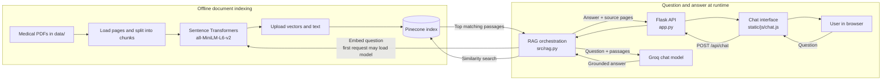

# CareGuide Medical Q&A

CareGuide is a retrieval-augmented medical information app. It reads local PDFs,
embeds their text with Sentence Transformers, stores vectors in Pinecone,
retrieves relevant passages, and asks Groq to answer from those passages. The
Netlify-hosted browser sends each visitor's Groq key through a rate-limited
Netlify function to the Python API. The Python backend keeps the Pinecone key.

CareGuide is for general education. It does not diagnose, prescribe, or replace
care from a qualified clinician.

## How a question is answered

1. `src/helper.py` loads PDF pages and splits them into overlapping chunks while
   keeping each PDF filename and page number.
2. `src/vector_store.py` embeds the chunks with
   `sentence-transformers/all-MiniLM-L6-v2` and upserts them to the configured
   Pinecone index.
3. `src/rag.py` retrieves the closest passages, adds source markers, and sends
   them with the question to Groq.
4. `src/prompt.py` tells the model to stay grounded in the passages and answer
   cautiously.
5. `app.py` returns the answer and source pages to the chat interface.

## Architecture



The embedding model runs locally and is cached while the Python process stays
running. Pinecone retrieval and Groq answer generation are network calls; these
steps, along with cold starts, contribute to response latency.

## Project layout

```text
medical-chatbot/
|-- app.py                     # Flask API
|-- store_index.py             # PDF indexing command
|-- templates/chat.html        # Local Flask chat UI
|-- public/                    # Netlify UI and browser assets
|-- netlify/functions/chat.mjs # Rate-limited API proxy
|-- src/                       # PDF, RAG, prompt, and Pinecone modules
|-- tests/                     # Provider-free tests
|-- data/                      # Medical reference PDFs
|-- pyproject.toml / uv.lock   # Python dependencies and lock
`-- netlify.toml               # Netlify site settings
```

## Setup (Windows PowerShell)

### 1. Install Python and uv

Use Python 3.11 and install [uv](https://docs.astral.sh/uv/getting-started/installation/).
Open PowerShell in the project directory. The same commands work from a
terminal opened in the repository root.

### 2. Create the environment and install packages

```powershell
uv sync
```

### 3. Configure API keys

Create a Pinecone API key in the [Pinecone Console](https://app.pinecone.io/).
Each visitor supplies their own Groq key in the chat page. Pinecone is shared by
the application to search its medical library.

```powershell
Copy-Item .env.example .env
```

Open `.env` and replace the example value for `PINECONE_API_KEY`. Keep `.env`
private; it is ignored by Git. The defaults use
Pinecone index `medical-bot`, AWS `us-east-1`, the 384-dimensional MiniLM
embedding model, and Groq model `openai/gpt-oss-120b`. Change settings in `.env`
if your Pinecone project or Groq account uses different values.

### 4. Build the Pinecone index from the PDFs

Put PDFs under `data/`, then run:

```powershell
uv run python store_index.py
```

The first run creates the Pinecone index if needed, downloads the embedding
model, and uploads document chunks. Repeat this command after adding or
updating PDFs. The embedding model and index dimension must stay compatible;
the included model produces 384-dimensional vectors.

### 5. Start the web app

```powershell
uv run flask --app app run
```

Add `--debug` only while developing locally if you need Flask's debugger.

Open <http://127.0.0.1:5000>, enter your Groq API key, and ask a question.
Check <http://127.0.0.1:5000/health> for the
local server liveness response. `GET /api/chat` is not used; the browser sends
`POST /api/chat` with `{"message":"your question"}`.

For the equivalent Python entry point, use `uv run python app.py`. The Flask
development server is for local use only. For a Linux container or Linux host,
start the app with Gunicorn:

```sh
uv run gunicorn --workers 2 --bind 0.0.0.0:${PORT:-8000} --timeout 120 app:app
```

For Windows, use Waitress:

```powershell
uv run waitress-serve --host=127.0.0.1 --port=8000 app:app
```

Put a TLS-enabled reverse proxy or managed HTTPS service in front of the
production server. Store provider keys in the host's secret manager, bind only
to the network interface required by the host, and set request/time limits at
the proxy too. These commands provide a production WSGI entry point; they do
not by themselves make a public deployment safe from abuse or establish a
privacy/compliance program.

## Run checks

```powershell
uv run python -m unittest discover -s tests -v
```

The route tests use a local mock answer and do not call Groq or Pinecone.

## Deploy the web interface on Netlify

Netlify hosts the static interface and rate-limited proxy. The Python Flask API
must run separately on a Python web service such as Render; Netlify Functions
do not run this Flask application. Keep the Python API on HTTPS.

1. Deploy this repository as a Python web service. Use Python 3.11, use
   `pip install -r requirements.txt` as the build command, and start with:

   ```sh
   gunicorn --workers 1 --threads 4 --bind 0.0.0.0:$PORT --timeout 60 app:app
   ```

   Set `PINECONE_API_KEY`, `PINECONE_INDEX_NAME`, and a unique
   `NETLIFY_PROXY_TOKEN` in the backend host's secret settings, and set
   `REQUIRE_NETLIFY_PROXY=1` so the API fails closed if the token is missing.
   Use an instance
   with enough memory for PyTorch and the sentence-transformer model; 2 GB RAM
   is a reasonable starting point. Index the PDFs before enabling chat.

2. In Netlify, import the same Git repository. Set the publish directory to
   `public` and the Functions directory to `netlify/functions` (already set in
   `netlify.toml`). Set `BACKEND_URL` to the backend's HTTPS origin and
   `NETLIFY_PROXY_TOKEN` to the same private token as the backend. Give
   both variables the Functions runtime scope. Generate a random token of at
   least 32 bytes.

3. Deploy and inspect the Netlify deploy log to confirm the chat function and
   its rate-limit rule were accepted. The current rule limits each IP to 8 chat
   requests per 60 seconds. Netlify notes that enforcement can take up to about
   10 seconds to catch up, and IP-based limits are not an absolute global usage
   cap. Monitor provider usage and set provider-side spending controls too.

4. Test the published site with a Groq key, check `/health` on the backend,
   confirm requests without the private proxy token are rejected, and verify
   over-limit chat requests receive HTTP 429.

Visitor Groq keys are held in the page only until it is refreshed or closed and
are forwarded for the chat request; this application does not intentionally
store them. The key passes through Netlify and the Python service, so only use a
key you control and rotate it if you suspect it was exposed. The Pinecone key
stays in the Python host's secret settings. Neither key should be committed.

## Configuration

| Variable | Required | Purpose |
| --- | --- | --- |
| Groq API key | Per visitor | Each visitor enters a key in the page; it is not a server environment variable |
| `PINECONE_API_KEY` | Yes | Authenticate index creation and vector search |
| `NETLIFY_PROXY_TOKEN` | Deployment | Shared secret between the Netlify function and Python API |
| `REQUIRE_NETLIFY_PROXY` | Deployment | Set to `1` on the API host to require proxy authentication |
| `BACKEND_URL` | Netlify | HTTPS origin of the Python API |
| `PINECONE_INDEX_NAME` | No | Index name; defaults to `medical-bot` |
| `PINECONE_CLOUD` | No | Cloud for a new serverless index; defaults to `aws` |
| `PINECONE_REGION` | No | Region for a new index; defaults to `us-east-1` |
| `PINECONE_NAMESPACE` | No | Namespace shared by indexing and retrieval |
| `GROQ_MODEL` | No | Groq model ID; defaults to `openai/gpt-oss-120b` |
| `EMBEDDING_MODEL` | No | Sentence Transformers model; defaults to MiniLM L6 v2 |
| `RETRIEVER_K` | No | Number of passages retrieved; defaults to `4` |
| `PDF_DATA_DIR` | No | Source folder for indexing; defaults to `data/` |
| `HOST`, `PORT` | No | Local app bind settings; defaults to `127.0.0.1:5000` |

## Troubleshooting

- **Missing key:** check `.env` spelling and restart the server after editing it.
- **Index does not exist:** run `uv run python store_index.py` before starting
  chat. Verify both commands use the same index and namespace settings.
- **Dimension mismatch:** use a new Pinecone index when changing to an embedding
  model with a different vector dimension.
- **No PDFs found:** place at least one readable `.pdf` under `data/`, or set
  `PDF_DATA_DIR` to another folder.
- **First request is slow:** the embedding model may need to download once and
  the Pinecone/Groq clients initialize on first use.

## Security and privacy

- Keep `.env` and API keys private. Rotate a key immediately if it is committed
  or shared accidentally.
- Questions are sent to Groq to generate answers. Avoid entering names, contact
  details, medical record numbers, or other information that identifies a person.
- The app returns browser security headers and limits chat request size. Keep
  it on localhost for development; public deployments need HTTPS, a production
  WSGI server, access controls appropriate to your audience, and provider-side
  privacy review.
- Responses are general educational information. They can be wrong or incomplete
  and are not a substitute for urgent or individualized medical care.

## Contributing

Contributions are welcome. Open an issue to describe a bug or proposed change,
then submit a pull request with a clear summary and any relevant screenshots or
reproduction steps. Keep changes focused, never include real credentials or
identifiable health information, and update the documentation when setup or
behavior changes. Run the checks above before submitting.

## Project owner

Maintainer: **Madhukar Reddy Donala** (listed in the project metadata). Contact
and author links can be added here by the maintainer when ready.


## Deployment image

The existing AWS ECR image repository is
`235348252915.dkr.ecr.ap-southeast-2.amazonaws.com/medicalchatbot`. Publishing
or pulling a deployment image requires AWS access and is separate from the
local setup above.
