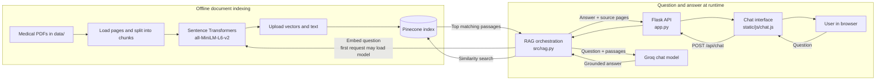

# CareGuide Medical Q&A

CareGuide is a small retrieval-augmented medical information app. It reads local
PDFs, embeds their text with Sentence Transformers, stores vectors in Pinecone,
retrieves relevant passages for each question, and asks a Groq chat model to
answer from those passages. The browser talks only to the Flask API; provider
keys stay on the server.

CareGuide is for general education. It does not diagnose, prescribe, or replace
care from a qualified clinician.

## How a question is answered

1. `src/helper.py` loads PDF pages and splits them into overlapping chunks while
   keeping each PDF filename and page number.
2. `src/vector_store.py` embeds the chunks with
   `sentence-transformers/all-MiniLM-L6-v2` and upserts them to the configured
   Pinecone index.
3. `src/rag.py` retrieves the closest passages, adds source markers, and sends
   them with the question to Groq.
4. `src/prompt.py` tells the model to stay grounded in the passages and answer
   cautiously.
5. `app.py` returns the answer and source pages to the chat interface.

## Architecture



The embedding model runs locally and is cached while the Flask process stays
running. Pinecone retrieval and Groq answer generation are network calls; these
steps, along with first-use initialization, contribute to response latency.

## Project layout

```text
medical-chatbot/
├── app.py                 # Flask page and JSON API routes
├── store_index.py         # One-time/repeatable PDF indexing command
├── data/                  # Source PDFs (Medical_book.pdf is included)
├── templates/
│   └── chat.html          # Chat page markup
├── static/
│   ├── css/chat.css       # Responsive interface styles
│   └── js/chat.js         # Browser/API interaction
├── src/
│   ├── helper.py          # PDF loading, chunking, embeddings
│   ├── prompt.py          # Grounded medical answer prompt
│   ├── rag.py             # Retrieval and Groq answer flow
│   └── vector_store.py    # Pinecone setup, ingestion, and connection
├── tests/                 # Local route and validation tests
├── .env.example           # Configuration template (no real keys)
├── pyproject.toml         # Project dependencies and uv configuration
└── README.md
```

## Setup (Windows PowerShell)

### 1. Install Python and uv

Use Python 3.11 and install [uv](https://docs.astral.sh/uv/getting-started/installation/).
Open PowerShell in the project directory.

### 2. Create the environment and install packages

```powershell
uv sync
```

### 3. Configure API keys

Create a Groq API key in the [Groq Console](https://console.groq.com/keys) and
a Pinecone API key in the [Pinecone Console](https://app.pinecone.io/).
Pinecone indexing and Groq chat both need active accounts.

```powershell
Copy-Item .env.example .env
```

Open `.env` and replace the example values for `GROQ_API_KEY` and
`PINECONE_API_KEY`. Keep `.env` private; it is ignored by Git. The defaults use
Pinecone index `medical-bot`, AWS `us-east-1`, the 384-dimensional MiniLM
embedding model, and Groq model `openai/gpt-oss-120b`. Change settings in `.env`
if your Pinecone project or Groq account uses different values.

### 4. Build the Pinecone index from the PDFs

Put PDFs under `data/`, then run:

```powershell
uv run python store_index.py
```

The first run creates the Pinecone index if needed, downloads the embedding
model, and uploads document chunks. Repeat this command after adding or
updating PDFs. The embedding model and index dimension must stay compatible;
the included model produces 384-dimensional vectors.

### 5. Start the web app

```powershell
uv run flask --app app run --debug
```

Open <http://127.0.0.1:5000>. Check <http://127.0.0.1:5000/health> for the
local server liveness response. `GET /api/chat` is not used; the browser sends
`POST /api/chat` with `{"message":"your question"}`.

## Run checks

```powershell
uv run python -m unittest discover -s tests -v
```

The route tests use a local mock answer and do not call Groq or Pinecone.

## Configuration

| Variable | Required | Purpose |
| --- | --- | --- |
| `GROQ_API_KEY` | Yes | Authenticate chat requests with Groq |
| `PINECONE_API_KEY` | Yes | Authenticate index creation and vector search |
| `PINECONE_INDEX_NAME` | No | Index name; defaults to `medical-bot` |
| `PINECONE_CLOUD` | No | Cloud for a new serverless index; defaults to `aws` |
| `PINECONE_REGION` | No | Region for a new index; defaults to `us-east-1` |
| `PINECONE_NAMESPACE` | No | Namespace shared by indexing and retrieval |
| `GROQ_MODEL` | No | Groq model ID; defaults to `openai/gpt-oss-120b` |
| `EMBEDDING_MODEL` | No | Sentence Transformers model; defaults to MiniLM L6 v2 |
| `RETRIEVER_K` | No | Number of passages retrieved; defaults to `4` |
| `PDF_DATA_DIR` | No | Source folder for indexing; defaults to `data/` |
| `HOST`, `PORT` | No | Local app bind settings; defaults to `127.0.0.1:5000` |

## Troubleshooting

- **Missing key:** check `.env` spelling and restart the server after editing it.
- **Index does not exist:** run `uv run python store_index.py` before starting
  chat. Verify both commands use the same index and namespace settings.
- **Dimension mismatch:** use a new Pinecone index when changing to an embedding
  model with a different vector dimension.
- **No PDFs found:** place at least one readable `.pdf` under `data/`, or set
  `PDF_DATA_DIR` to another folder.
- **First request is slow:** the embedding model may need to download once and
  the Pinecone/Groq clients initialize on first use.
